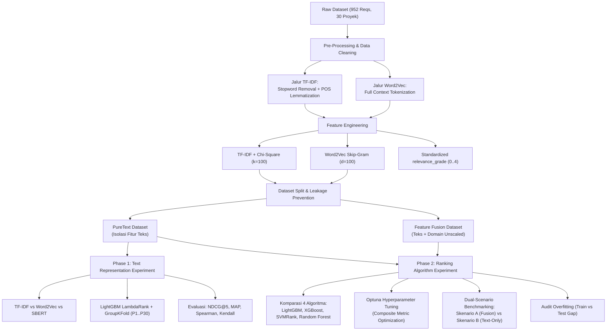

# Research: Software Requirement Prioritization using NLP & Learning-to-Rank (LTR)

Repositori ini memuat seluruh artefak, dataset, kode prapemrosesan (*preprocessing*), rekayasa fitur (*feature engineering*), serta eksperimen pemodelan pembelajaran mesin untuk penelitian **Pemeringkatan Kebutuhan Perangkat Lunak (*Software Requirement Prioritization / SRP*)** berbasis representasi teks **Natural Language Processing (NLP)** dan algoritma **Learning-to-Rank (LTR)**.

Penelitian ini bertujuan untuk mengotomatisasi proses penentuan prioritas kebutuhan perangkat lunak (kategori *Functional* dan *Non-Functional Requirements*) secara objektif, bebas kebocoran data (*leak-free*), dan terukur dengan metrik evaluasi pemeringkatan standar industri.

---

## 📌 Daftar Isi
1. [Ringkasan Penelitian](#-ringkasan-penelitian)
2. [Struktur Direktori & Folder](#-struktur-direktori--folder)
3. [Alur Pipeline Metodologi Riset](#-alur-pipeline-metodologi-riset)
   - [Tahap 0: Dataset Mentah & Karakteristik Data](#tahap-0-dataset-mentah--karakteristik-data)
   - [Tahap 1: Text Preprocessing & Cleaning](#tahap-1-text-preprocessing--cleaning)
   - [Tahap 2: Feature Engineering & Anti-Data-Leakage Design](#tahap-2-feature-engineering--anti-data-leakage-design)
   - [Tahap 3: Riset Phase 1 — Eksperimen Representasi Teks](#tahap-3-riset-phase-1--eksperimen-representasi-teks)
   - [Tahap 4: Riset Phase 2 — Eksperimen Algoritma LTR & Hyperparameter Tuning](#tahap-4-riset-phase-2--eksperimen-algoritma-ltr--hyperparameter-tuning)
4. [Kamus Data (Data Dictionary)](#-kamus-data-data-dictionary)
5. [Ringkasan Hasil Eksperimen](#-ringkasan-hasil-eksperimen)
   - [Hasil Phase 1: Group K-Fold Cross-Validation](#hasil-phase-1-group-k-fold-cross-validation-puretext)
   - [Hasil Phase 2: Komparasi 4 Algoritma LTR (Dual-Scenario)](#hasil-phase-2-komparasi-4-algoritma-ltr-dual-scenario)
   - [Audit Generalisasi & Overfitting](#audit-generalisasi--overfitting)
6. [Panduan Instalasi & Menjalankan Eksperimen](#-panduan-instalasi--menjalankan-eksperimen)
7. [Tracking Eksperimen dengan MLflow](#-tracking-eksperimen-dengan-mlflow)

---

## 🔬 Ringkasan Penelitian

*Software Requirement Prioritization* merupakan aktivitas krusial dalam siklus hidup rekayasa perangkat lunak (*Requirements Engineering*) untuk menentukan urutan implementasi fitur berdasarkan nilai bisnis (*value*), estimasi biaya/waktu (*effort*), tingkat risiko (*risk*), dan preferensi pemangku kepentingan (*stakeholder priority*).

Penelitian pada repositori ini dirancang dalam dua fase utama:
1. **Phase 1 (Text Representation Experiment)**: Menguji dan membandingkan representasi teks:
   - **TF-IDF** (Statistik term frequency + Chi-Square selection)
   - **Word2Vec** (Dense word embeddings, Skip-Gram architecture)
   - **SBERT** (Sentence-BERT contextual transformer embeddings)
   Evaluasi dilakukan menggunakan algoritma **LightGBM LambdaRank** dengan validasi silang ketat **Group K-Fold Cross-Validation (GKF)** berbasis ID proyek.
2. **Phase 2 (Ranking Algorithm Experiment & Feature Ablation)**: Menguji 4 algoritma pemeringkatan:
   - **LightGBM Ranker** (LambdaRank)
   - **XGBoost Ranker** (Pairwise / NDCG objective)
   - **SVMRank** (Pairwise Linear Support Vector Machine)
   - **Random Forest Ranker** (Pointwise baseline)
   Dilengkapi dengan **Hyperparameter Tuning otomatis via Optuna**, akselerasi GPU (CUDA), audit *overfitting*, serta studi komparasi dua skenario:
   - **Skenario A (Feature Fusion)**: Menggabungkan fitur teks NLP dan fitur domain kuantitatif bisnis.
   - **Skenario B (Text-Only NLP)**: Murni mengevaluasi daya prediksi fitur teks deskripsi kebutuhan perangkat lunak.

---

## 📂 Struktur Direktori & Folder

Berikut adalah peta struktur repositori beserta peruntukan setiap komponennya:

```text
Riset TEMP/
│
├── README.md                                      # Dokumentasi komprehensif repositori (file ini)
│
├── datasets_raw/                                  # Penyimpanan dataset mentah sebelum pembersihan
│   └── Dataset_recalculated_priority.xlsx         # Dataset awal berisi 952 baris requirement dari 30 proyek
│
├── Pre-Processing-TFIDF-W2V/                      # Notebook prapemrosesan teks & rekayasa fitur
│   ├── [New_Implement]_Requirement_Dataset_Cleaning_Fixed.ipynb  # Pipeline pembersihan teks (TF-IDF & W2V)
│   └── Feature_Engineering_Research_Dataset.ipynb # Pipeline pembentukan fitur NLP, Chi-sq, L2 norm, & target LTR
│
├── dataset/                                       # Dataset bersih siap proses hasil dari Pre-Processing
│   ├── Dataset.xlsx                               # Master dataset awal
│   ├── Dataset_Cleaned.csv / .xlsx                # Dataset setelah pembersihan dasar
│   ├── Dataset_Cleaned_TFIDF.csv / .xlsx          # Dataset siap ekstraksi TF-IDF (lemmatized & stopword removed)
│   ├── Dataset_Cleaned_W2V.csv / .xlsx            # Dataset siap ekstraksi Word2Vec (full contextual tokens)
│   ├── Dataset_recalculated_priority.xlsx         # Dataset dengan kalkulasi priority_score terverifikasi
│   └── Dataset_Research_Master_Readable.xlsx      # Master dataset referensi manusia (human-readable)
│
├── output_datasets/                               # Dataset final siap latih (training-ready) dan untuk arsip/EDA
│   ├── Dataset_Training_TFIDF_PureText.csv        # Fitur murni TF-IDF (100 term terpilih Chi-Square)
│   ├── Dataset_Training_TFIDF_Fusion.csv          # Fitur TF-IDF + 4 fitur domain unscaled (anti-leakage)
│   ├── Dataset_Training_Word2Vec_PureText.csv     # Fitur murni Word2Vec (100 dimensi vektor kalimat)
│   ├── Dataset_Training_Word2Vec_Fusion.csv       # Fitur Word2Vec + 4 fitur domain unscaled
│   ├── Dataset_EDA_TFIDF.csv / Ready_TFIDF.xlsx   # Versi scaled (Z-score) untuk eksplorasi dan arsip
│   └── Dataset_EDA_Word2Vec.csv / Ready_W2V.xlsx  # Versi scaled (Z-score) untuk eksplorasi dan arsip
│
├── riset-phase-1/                                 # Eksperimen Fase 1: Perbandingan Representasi Teks
│   ├── phase_1_tfidf.ipynb                        # Eksperimen TF-IDF (Single Project-based Split)
│   ├── phase_1_tfidf_gkf.ipynb                    # Eksperimen TF-IDF (Group K-Fold Cross-Validation)
│   ├── phase_1_w2v.ipynb                          # Eksperimen Word2Vec (Single Split)
│   ├── phase_1_w2v_gkf.ipynb                      # Eksperimen Word2Vec (Group K-Fold Cross-Validation)
│   ├── phase_1_sbert.ipynb                        # Eksperimen SBERT (Single Split)
│   ├── phase_1_sbert_gkf.ipynb                    # Eksperimen SBERT (Group K-Fold Cross-Validation)
│   ├── requirements.txt                           # Dependensi Python khusus Phase 1
│   ├── test_run.py                                # Skrip uji coba batch execution & MLflow logging
│   ├── mlflow-ui.bat                              # Launcher cepat MLflow dashboard (port 5055)
│   ├── dataset/                                   # Dataset lokal untuk Phase 1 (TFIDF, W2V, SBert)
│   └── outputs/                                   # Artefak model (.pkl), metrik evaluasi (.json), OOF preds (.csv)
│       ├── phase1_tfidf/ & phase1_tfidf_gkf/
│       ├── phase1_word2vec/ & phase1_w2v_gkf/
│       └── phase1_sbert/ & phase1_sbert_gkf/
│
└── riset-phase-2/                                 # Eksperimen Fase 2: Perbandingan 4 Algoritma LTR
    ├── riset-phase-2.ipynb                        # Eksperimen baseline 4 algoritma LTR
    ├── riset-phase-2-tuning.ipynb                 # Eksperimen 4 algoritma dengan hyperparameter tuning Optuna
    ├── riset-phase-2-advanced-tuning.ipynb        # Eksperimen tingkat lanjut: GPU CUDA, Dual-Scenario, Overfit Audit
    ├── requirements.txt                           # Dependensi Python khusus Phase 2
    ├── mlflow.db                                  # Database SQLite backend penyimpanan run MLflow
    ├── mlruns/                                    # Direktori artefak model & metrik MLflow
    └── results/                                   # Output hasil evaluasi, komparasi model, dan model final (.pkl)
        ├── best_ranking_model_advanced.pkl        # Model pemeringkat terbaik yang tersimpan
        ├── phase_2_advanced_model_comparison.csv  # Tabel komparasi metrik seluruh model (Fusion vs NLP)
        ├── phase_2_train_vs_test_comparison.csv   # Evaluasi train vs test gap untuk deteksi overfitting
        ├── phase_2_advanced_predictions.csv       # Hasil prediksi rank data uji
        └── models_advanced/                       # Model pickle individual (LightGBM, XGBoost, SVMRank, RF)
```

---

## 🔄 Alur Pipeline Metodologi Riset



---

### Tahap 0: Dataset Mentah & Karakteristik Data
- **Jumlah Data**: 952 baris kebutuhan perangkat lunak dari **30 proyek rekayasa perangkat lunak yang berbeda** (`P1` hingga `P30`).
- **Kategori Kebutuhan**:
  - `FR` (*Functional Requirement*): Kebutuhan operasional fungsional sistem.
  - `NFR` (*Non-Functional Requirement*): Kebutuhan kualitas, keamanan, kepatuhan, atau performa.
- **Variabel Domain Kuantitatif**:
  - `value`: Nilai bisnis kebutuhan.
  - `effort`: Estimasi tingkat kesulitan atau waktu pengimplementasian.
  - `risk`: Potensi risiko teknis/bisnis jika kebutuhan diimplementasikan atau gagal diimplementasikan.
  - `stakeholder_priority`: Prioritas yang diberikan oleh pemangku kepentingan (*user/client*).
- **Target Awal**:
  - `priority_score`: Nilai skalar hasil pembobotan atribut domain.
  - `rank`: Peringkat relatif kebutuhan dalam masing-masing proyek (1 = prioritas paling tinggi).

---

### Tahap 1: Text Preprocessing & Cleaning
Dijalankan pada notebook `[New_Implement]_Requirement_Dataset_Cleaning_Fixed.ipynb`:
1. **Pembersihan Teks Dasar**: Konversi huruf kecil (*case folding*), eliminasi URL, penanganan singkatan (`e.g.`, `i.e.`), penggabungan kata majemuk (*compound words*), pemisahan strategi angka, dan penghapusan tanda baca.
2. **Tokenisasi**: Menggunakan tokeniser standar NLTK `word_tokenize`.
3. **Percabangan Jalur Pemrosesan Teks**:
   - **Jalur TF-IDF**: Menerapkan penghapusan *stopword* bahasa Inggris ditambah *domain-specific stopword*, namun **mempertahankan kata kunci modalitas prioritas** (*whitelist*) seperti `shall`, `must`, `should`, dan kata kerja operasi CRUD (`create`, `read`, `update`, `delete`, `manage`). Dilanjutkan dengan *POS-guided Lemmatization* menggunakan `WordNetLemmatizer` untuk akurasi bentuk dasar kata.
   - **Jalur Word2Vec**: Mempertahankan urutan token kontekstual kalimat penuh tanpa pemotongan agresif untuk menjaga semantik kalimat.
4. **Deduplikasi Data**: Melakukan audit duplikasi teks eksak dan semantik untuk memastikan validitas sampel.

---

### Tahap 2: Feature Engineering & Anti-Data-Leakage Design
Dijalankan pada notebook `Feature_Engineering_Research_Dataset.ipynb`:
1. **Natural Sorting**: Mengurutkan proyek (`P1..P30`) dan requirement (`REQ-01..REQ-952`) secara numerik stabil untuk sinkronisasi antareksperimen.
2. **Standardisasi Target LTR (`relevance_grade`)**:
   Untuk memenuhi format model *Learning-to-Rank* (seperti LambdaRank) dan metrik NDCG, `priority_score` didiskritisasi per proyek ke dalam 5 tingkatan relevansi ($0 \dots 4$):
   $$\text{relevance\_grade} \in \{0, 1, 2, 3, 4\}$$
   di mana nilai 4 merepresentasikan top 20% kebutuhan paling kritis dalam proyek tersebut.
3. **Ekstraksi Fitur Teks**:
   - **TF-IDF + Chi-Square**: Menggunakan `sublinear_tf=True`, rentang n-gram unigram dan bigram `(1, 2)`, frekuensi minimum `min_df=2`, lalu diseleksi 100 fitur terbaik menggunakan uji statistik `SelectKBest(chi2, k=100)` terhadap `relevance_grade`.
   - **Word2Vec**: Pelatihan arsitektur Skip-gram (`sg=1`, jendela konteks `window=5`, dimensi vektor 100, 50 *epochs*, hash deterministik), lalu menghitung rata-rata vektor kata tiap dokumen dengan **L2-Normalization**.
4. **Pencegahan Kebocoran Data (*Anti-Data-Leakage*)**:
   - **PureText Dataset (104 kolom)**: Fitur murni teks (100 kolom NLP + `type_encoded` + `project_id`, `rank`, `relevance_grade`). Fitur domain sengaja dihilangkan untuk menguji kapasitas murni representasi teks tanpa membocorkan formula prioritas.
   - **Fusion Dataset (108 kolom)**: Menyertakan fitur domain kuantitatif dalam skala asli (*unscaled*). Normalisasi (*StandardScaler* atau *MinMaxScaler*) harus dijalankan secara *in-fold* di dalam loop validasi silang.

---

### Tahap 3: Riset Phase 1 — Eksperimen Representasi Teks
Berlokasi di folder `riset-phase-1/`:
- **Tujuan**: Menentukan metode representasi teks terbaik untuk pemeringkatan kebutuhan perangkat lunak murni teks.
- **Varian yang dibandingkan**:
  1. `TF-IDF` (Frekuensi statistik + n-grams + Chi-square)
  2. `Word2Vec` (Representasi semantik kata padat / dense embeddings)
  3. `SBERT` (*Sentence-BERT* / Transformer contextual sentence embeddings)
- **Metodologi Validasi**:
  - Menggunakan algoritma **LightGBM LambdaRank**.
  - **Group K-Fold Cross-Validation (GKF)** dengan `project_id` sebagai kelompok query. Hal ini menjamin bahwa seluruh requirement dari 1 proyek berada utuh di set pelatihan atau set pengujian (0% data overlap/kebocoran antarkelompok proyek).
- **Metrik Evaluasi**:
  - `NDCG@5` & `NDCG@10` (*Normalized Discounted Cumulative Gain*)
  - `MAP` (*Mean Average Precision*)
  - `Spearman's Rank Correlation Coefficient` ($\rho$)
  - `Kendall's Tau Rank Correlation` ($\tau$)

---

### Tahap 4: Riset Phase 2 — Eksperimen Algoritma LTR & Hyperparameter Tuning
Berlokasi di folder `riset-phase-2/`:
- **Tujuan**: Mengkomparasikan 4 keluarga algoritma *Learning-to-Rank* dan mengukur kontribusi fitur domain terhadap teks murni.
- **4 Algoritma yang Diuji**:
  1. **LightGBM Ranker** (LambdaRank dengan objective `lambdarank`)
  2. **XGBoost Ranker** (Objective `rank:pairwise` / `rank:ndcg`)
  3. **SVMRank** (Pairwise Linear Support Vector Machine dengan transformasi selisih pasangan fitur $x_i - x_j$)
  4. **Random Forest Ranker** (Pointwise tree regression/classification)
- **Metodologi & Teknik Tingkat Lanjut**:
  - **Optuna Hyperparameter Tuning**: Optimasi Bayesian dengan fungsi tujuan gabungan (*Composite Metric*):
    $$\text{Objective} = 0.4 \times \text{NDCG@5} + 0.3 \times \text{MAP} + 0.2 \times \text{Spearman} + 0.1 \times \text{Kendall}$$
  - **Akselerasi GPU**: Deteksi otomatis NVIDIA CUDA untuk mempercepat proses tuning iteratif XGBoost dan LightGBM.
  - **Dual-Scenario Benchmarking**:
    - **Skenario A (Feature Fusion)**: Fitur Domain (`value`, `effort`, `risk`, `stakeholder_priority`) + Fitur Teks NLP.
    - **Skenario B (Text-Only NLP)**: Murni fitur teks NLP tanpa data domain.
  - **Audit Overfitting**: Perhitungan performa pada *Train Set* vs. *Test Set* serta kalkulasi selisih (*generalization gap*) untuk mengidentifikasi apakah model menghafal data (*memorization*) atau mampu menggeneralisasi ke proyek perangkat lunak baru.

---

## 📊 Kamus Data (Data Dictionary)

### 1. Kolom Dataset Mentah / Cleaned Dasar
| Nama Kolom | Tipe Data | Deskripsi |
| :--- | :--- | :--- |
| `id` | String | Pengidentifikasi unik kebutuhan (contoh: `REQ-01`, `REQ-02`). |
| `project_id` | String | Pengidentifikasi proyek perangkat lunak (`P1` sampai `P30`). |
| `requirement_text`| String | Teks asli deskripsi kebutuhan perangkat lunak. |
| `cleaned_text` | String | Teks setelah proses pembersihan (*lowercased, normalized, lemmatized*). |
| `type` | String | Kategori kebutuhan: `FR` (*Functional*) atau `NFR` (*Non-Functional*). |
| `value` | Integer | Skor nilai bisnis / manfaat dari kebutuhan (skala 1-5). |
| `effort` | Integer | Skor estimasi upaya / kesulitan teknis pengerjaan (skala 1-5). |
| `risk` | Integer | Skor potensi risiko kegagalan atau kendala (skala 1-5). |
| `stakeholder_priority` | Integer | Skor prioritas langsung dari pemangku kepentingan (skala 1-5). |
| `priority_score` | Float | Skor gabungan penentu prioritas kebutuhan. |
| `rank` | Integer | Peringkat kebutuhan dalam proyek yang bersangkutan ($1 = \text{tertinggi}$). |

### 2. Kolom Tambahan Hasil Feature Engineering
| Nama Kolom | Tipe Data | Deskripsi |
| :--- | :--- | :--- |
| `type_encoded` | Integer | Representasi biner: $1 = \text{FR}$, $0 = \text{NFR}$. |
| `relevance_grade` | Integer | Target pemeringkatan diskrit LTR ($0 \dots 4$) berdasarkan persentil per proyek. |
| `tfidf_*` (100 kolom) | Float | Bobot TF-IDF per term terpilih berdasarkan seleksi Chi-Square. |
| `w2v_dim_*` (100 kolom)| Float | Komponen vektor dense rata-rata kalimat yang telah di-L2 normalisasi. |

---

## 📈 Ringkasan Hasil Eksperimen

### Hasil Phase 1: Group K-Fold Cross-Validation (PureText)
Hasil evaluasi rata-rata (± standar deviasi) LightGBM LambdaRank lintas seluruh fold proyek:

| Representasi Teks | NDCG@5 (Mean ± Std) | NDCG@10 (Mean ± Std) | MAP (Mean ± Std) | Spearman $\rho$ (Mean ± Std) |
| :--- | :---: | :---: | :---: | :---: |
| **Word2Vec** | **0.7264 ± 0.094** | **0.7656 ± 0.079** | 0.6939 ± 0.105 | 0.2007 ± 0.146 |
| **SBERT** | 0.7031 ± 0.078 | 0.7525 ± 0.095 | **0.7351 ± 0.077** | **0.2025 ± 0.167** |
| **TF-IDF** | 0.6164 ± 0.104 | 0.6909 ± 0.108 | 0.6105 ± 0.083 | 0.0878 ± 0.237 |

> **Temuan Phase 1**: Representasi semantik berbasis *dense embedding* (**Word2Vec** dan **SBERT**) secara konsisten mengungguli representasi frekuensi leksikal murni (**TF-IDF**) dalam konteks pemeringkatan teks murni bebas bocoran.

---

### Hasil Phase 2: Komparasi 4 Algoritma LTR (Dual-Scenario)
Evaluasi pada data uji (*Test Set*) untuk Skenario A (Feature Fusion) vs Skenario B (Text-Only NLP):

| Skenario | Model LTR | Spearman $\rho$ | Kendall's $\tau$ | NDCG@5 | MAP |
| :--- | :--- | :---: | :---: | :---: | :---: |
| **Skenario A (Fusion)** | **SVMRank** | **0.9831** | **0.9516** | **1.0000** | **1.0000** |
| **Skenario A (Fusion)** | **LightGBM Ranker** | **0.9665** | **0.9194** | **0.9929** | **0.9932** |
| **Skenario A (Fusion)** | **XGBoost Ranker** | 0.9492 | 0.8833 | 0.9929 | 0.9888 |
| **Skenario A (Fusion)** | Random Forest | 0.3778 | 0.2994 | 0.7403 | 0.7467 |
| *Skenario B (Text-Only)* | SVMRank | 0.0265 | 0.0186 | 0.5598 | 0.6765 |
| *Skenario B (Text-Only)* | LightGBM Ranker | -0.0089 | -0.0164 | 0.6141 | 0.6517 |
| *Skenario B (Text-Only)* | Random Forest | -0.0142 | -0.0157 | 0.5918 | 0.6685 |
| *Skenario B (Text-Only)* | XGBoost Ranker | -0.1976 | -0.1680 | 0.5784 | 0.6001 |

---

### Audit Generalisasi & Overfitting

| Skenario & Model | Train NDCG@5 | Test NDCG@5 | Gap NDCG@5 | Train Spearman | Test Spearman | Status Generalisasi |
| :--- | :---: | :---: | :---: | :---: | :---: | :--- |
| **Fusion: SVMRank** | 1.0000 | 1.0000 | 0.0000 | 0.9898 | 0.9831 | **Good Generalization** |
| **Fusion: LightGBM** | 0.9994 | 0.9929 | 0.0065 | 0.9828 | 0.9665 | **Good Generalization** |
| **Fusion: XGBoost** | 0.9886 | 0.9929 | -0.0043 | 0.9409 | 0.9492 | **Good Generalization** |
| **Fusion: Random Forest**| 0.8737 | 0.7403 | 0.1333 | 0.6564 | 0.3778 | *Severe Overfitting* |
| **Text-Only: Seluruh Model** | ~0.63 | ~0.58 | - | ~0.15 | $\le 0.02$ | *Poor Rank Transferability* |

> **Kesimpulan Ilmiah Utama**:
> 1. Pendekatan **Feature Fusion** (menggabungkan atribut kuantitatif domain dengan representasi NLP) memberikan hasil pemeringkatan yang mendekati sempurna (NDCG@5 $\ge 0.99$, Spearman $\ge 0.94$) dengan generalisasi yang sangat stabil antar proyek.
> 2. Model pairwise (*SVMRank, LightGBM LambdaRank, XGBoost Ranker*) jauh lebih unggul dibandingkan model pointwise tradisional (*Random Forest*).
> 3. Teks deskripsi kebutuhan saja (*Text-Only*) terbukti tidak memadai jika digunakan sendirian untuk memprediksi prioritas implementasi tanpa parameter biaya, risiko, dan nilai bisnis dari pemangku kepentingan.

---

## 💻 Panduan Instalasi & Menjalankan Eksperimen

### 1. Prasyarat Lingkungan
- Sistem Operasi: Windows 10/11, Linux, atau macOS.
- Python versi 3.10 atau lebih baru.
- (Opsional) GPU NVIDIA dengan CUDA untuk pelatihan cepat XGBoost/LightGBM.

### 2. Membuat Virtual Environment & Instalasi Dependensi
Buka terminal/PowerShell di direktori root `Riset TEMP`:

```powershell
# Buat virtual environment
python -m venv .venv

# Aktivasi virtual environment (Windows PowerShell)
.venv\Scripts\Activate.ps1

# Instal dependensi Phase 1 & Phase 2
pip install -r riset-phase-1/requirements.txt
pip install -r riset-phase-2/requirements.txt
pip install optuna nltk gensim
```

### 3. Urutan Eksekusi Notebook
Untuk mereproduksi seluruh hasil penelitian dari nol, jalankan notebook dengan urutan berikut:

1. **Pembersihan Data**:
   Buka dan jalankan seluruh cell pada:
   `Pre-Processing-TFIDF-W2V/[New_Implement]_Requirement_Dataset_Cleaning_Fixed.ipynb`
   *(Menghasilkan file di folder `dataset/`)*.

2. **Ekstraksi & Rekayasa Fitur**:
   Buka dan jalankan seluruh cell pada:
   `Pre-Processing-TFIDF-W2V/Feature_Engineering_Research_Dataset.ipynb`
   *(Menghasilkan variasi dataset di folder `output_datasets/`)*.

3. **Eksperimen Phase 1 (Representasi Teks)**:
   Jalankan notebook validasi silang pada folder `riset-phase-1/`:
   - `riset-phase-1/phase_1_tfidf_gkf.ipynb`
   - `riset-phase-1/phase_1_w2v_gkf.ipynb`
   - `riset-phase-1/phase_1_sbert_gkf.ipynb`

4. **Eksperimen Phase 2 (Algoritma LTR & Tuning)**:
   Jalankan notebook evaluasi dan tuning pada folder `riset-phase-2/`:
   - `riset-phase-2/riset-phase-2-advanced-tuning.ipynb`
   *(Menghasilkan model terbaik di `riset-phase-2/results/`)*.

---

## 📊 Tracking Eksperimen dengan MLflow

Seluruh metrik dan hyperparameter eksperimen tercatat secara otomatis menggunakan **MLflow**.

Untuk melihat antarmuka web dashboard MLflow lokal:
```powershell
# Dari folder riset-phase-1
cd riset-phase-1
.\mlflow-ui.bat

# Atau dari folder riset-phase-2
cd ..\riset-phase-2
mlflow ui --backend-store-uri sqlite:///mlflow.db --port 5000
```
Buka browser dan arahkan ke alamat `http://localhost:5000` atau `http://localhost:5055`.

